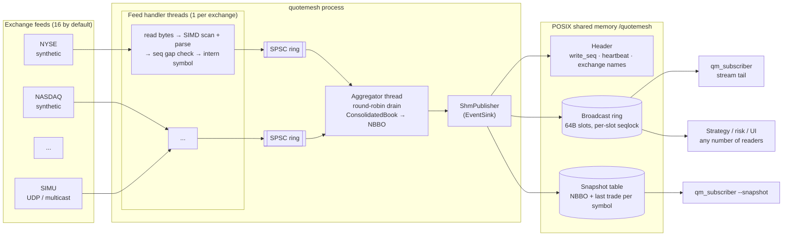

# QuoteMesh

**SIMD-accelerated multi-exchange market data aggregator in C++20.**

QuoteMesh takes in real-time quote and trade feeds from 15+ exchanges (16 by default) and parses
them with vectorised routines (AVX2, SSE2 or NEON). It builds a consolidated per-symbol book
holding each venue's best bid/offer and the derived **NBBO**, and sends every change to any
number of downstream processes through **lock-free shared memory**.

## Features

- **One feed-handler thread per exchange.** Each one reads raw bytes, parses them, detects
  sequence gaps and stale messages, and normalises the result into a `MarketEvent`.
- **SIMD parsing:**
  - A 64-byte structural scan turns `|` and `\n` into bitmasks (similar to simdjson's stage 1).
    The parser walks those masks with `countr_zero` instead of checking one byte at a time.
  - Decimal fields are parsed with SWAR for short values and a 16-lane multiply-add reduction
    (SSE4.1 or NEON) for long values such as nanosecond timestamps.
  - A scalar reference parser is kept, and differential tests check that both parsers give the
    same results.
- **Lock-free hand-off.** Each feed thread passes events to the single aggregator thread through
  its own cache-line padded SPSC ring. The aggregator drains the rings in round-robin order, so
  the hot path takes no locks.
- **Consolidated book.** For each symbol it keeps every venue's top of book. It builds the NBBO
  with aggregated size and a bitmask of the venues at the best price, and flags locked and
  crossed markets. If a quote can't affect the NBBO, the book skips the recompute.
- **Shared-memory IPC** (`shm_open` + `mmap`):
  - A broadcast ring of 64-byte, cache-line sized messages. Each slot has its own sequence
    number that works as a seqlock, so the writer never waits for readers. Slow readers detect
    when they've been overrun and resync.
  - A seqlock-protected snapshot table holding the latest NBBO and last trade for each symbol,
    so late joiners can catch up.
  - A heartbeat so subscribers can tell whether the publisher is still alive.
- **Feed sources.** A rate-limited synthetic generator (random walk, with simulated packet loss)
  and a non-blocking UDP unicast/multicast receiver. A UDP feed simulator is included.

## Architecture



Wire format (one message per line, `|`-delimited, prices with up to 4 decimals):

```
Q|<seq>|<symbol>|<exch_ts_ns>|<bid_px>|<bid_sz>|<ask_px>|<ask_sz>
T|<seq>|<symbol>|<exch_ts_ns>|<px>|<sz>
```

Shared-memory segment layout:

```
+------------------+ 0
| SegmentHeader    | magic, version, geometry, exchange names, write_seq, heartbeat
+------------------+ ring_offset
| RingSlot[cap]    | {seq, 56-byte payload} x capacity  (64 B each)
+------------------+ snapshot_offset
| SnapshotEntry[n] | {version (seqlock), SnapshotData} per SymbolId
+------------------+
```

## Project layout

```
include/quotemesh/        public headers
  simd/                   arch detection, delimiter scanner, number parsing
  shm/                    region, layout, broadcast ring, snapshot table, publisher, subscriber
src/                      library implementation
apps/                     quotemesh (daemon), qm_subscriber, qm_feedsim
bench/                    bench_parser, bench_pipeline
tests/                    GoogleTest suites
config/quotemesh.conf     sample configuration (16 exchanges)
```

## Requirements

- macOS or Linux (needs POSIX shared memory). Windows isn't supported.
- A C++20 compiler (Clang 14+, GCC 11+) and CMake 3.20+.
- Network access the first time you configure, because GoogleTest is fetched with
  `FetchContent`.
- No exchange connectivity or credentials are needed. Synthetic feeds are the default, and UDP
  feeds can be driven locally with `qm_feedsim`.
- Optional: an x86-64 CPU with AVX2/SSE4.1, or an ARM64 CPU (Apple Silicon, Graviton) for NEON.
  Other targets fall back to scalar code.

## Build

```bash
cmake -S . -B build -DCMAKE_BUILD_TYPE=Release
cmake --build build -j
```

CMake options:

| Option | Default | Meaning |
|---|---|---|
| `QM_NATIVE` | `ON` | compile with `-march=native` (enables AVX2/SSE4.1 when the CPU has them) |
| `QM_FORCE_SCALAR` | `OFF` | disable every SIMD path (reference build) |
| `QM_BUILD_TESTS` / `QM_BUILD_BENCH` / `QM_BUILD_APPS` | `ON` | toggle components |

## Run

**1. Start the aggregator.** With no arguments it uses 16 synthetic exchanges and 20 symbols:

```bash
./build/quotemesh                                    # defaults
./build/quotemesh --config config/quotemesh.conf     # from file
./build/quotemesh --set synthetic.rate=100000 --duration 30
./build/quotemesh --scalar                           # use the scalar parser for comparison
```

It prints throughput, gap and error counts, and feed-to-book latency percentiles once a second.
`Ctrl-C` shuts it down cleanly and removes the shm segment.

**2. Attach subscribers** from other terminals. You can run as many as you like:

```bash
./build/qm_subscriber                    # tail NBBO + trades
./build/qm_subscriber --symbol AAPL      # filter to one symbol
./build/qm_subscriber --snapshot         # consolidated table across all venues
./build/qm_subscriber --stats            # msgs/s, lag, loss, shm latency
```

**3. Optional: drive the UDP path.** Add UDP exchanges to the config (or use `--set`) and point
the simulator at them:

```bash
./build/quotemesh --set exchange.16="SIMU udp:31001"
./build/qm_feedsim --dest 127.0.0.1:31001 --rate 50000 --drop 0.001
```

Multicast works the same way: use `exchange.17 = SIMM mcast:239.1.1.1:31002` and run
`qm_feedsim --dest 239.1.1.1:31002`.

Environment variables (see `.env.example`):

- `QUOTEMESH_SHM_NAME` sets the shared-memory segment name for both the daemon and the
  subscriber.
- `QUOTEMESH_SYNTHETIC_RATE` overrides the synthetic message rate per exchange.

## Test

```bash
cmake -S . -B build && cmake --build build -j
ctest --test-dir build --output-on-failure
# or directly:
./build/tests/qm_tests
```

What the tests cover:

- **Parser:** encode/decode round-trips, rejection of malformed lines, partial-line handling.
- **SIMD:** checks the bitmasks and number parsing against the scalar path, then runs
  differential fuzzing of the full batch parser on clean and corrupted feeds.
- **SPSC queue:** capacity, batching, and order under a concurrent producer and consumer.
- **Book and aggregator:**
  - NBBO construction, size aggregation, venue back-off, crossed markets, clearing a venue.
  - Feed reassembly when messages are split across reads, and gap/stale detection.
  - A threaded run with 4 feeds through the aggregator.
- **Shared memory:** NBBO/trade delivery, snapshot reads, overrun recovery, and torn-read
  detection with a concurrent writer and reader. Also a round-trip through a named POSIX
  segment.
- **Config:** default settings, exchange specs, file loading, validation errors.

To check the scalar fallback, configure a separate build with `-DQM_FORCE_SCALAR=ON` and run
the same suite.

## Benchmarks

```bash
./build/bench_parser 1000000 10        # scalar vs SIMD parser (msgs/s, GB/s, ns/msg)
./build/bench_pipeline 16 1000000      # 16 feeds x 1M msgs end-to-end, plus a shm reader
./build/bench_pipeline 16 1000000 scalar
```

## Design notes

- **Fixed-point prices** (`int64`, 4 implied decimals), so the hot path does no floating-point
  math and price comparisons are exact.
- **Backpressure instead of drops.** If a feed handler's queue is full, it spins and counts the
  event rather than discarding a quote, because a silently lost quote would leave the book
  stale.
- **Readers never slow the writer.** The shm ring is a broadcast. A subscriber that falls more
  than `ring_capacity` messages behind jumps forward, reports how many messages it lost, and
  can rebuild its state from the snapshot table.
- **Cross-process atomics.** Payload words in shm are stored as relaxed `std::atomic<uint64_t>`,
  so seqlock reads are free of data races under the C++ memory model. A `static_assert`
  requires 64-bit atomics to be lock-free.
